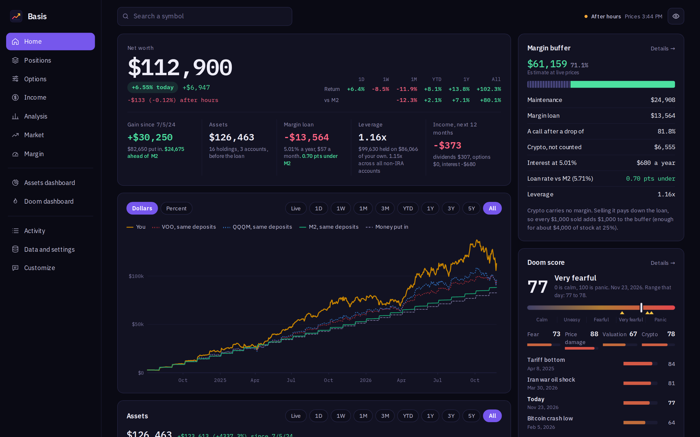
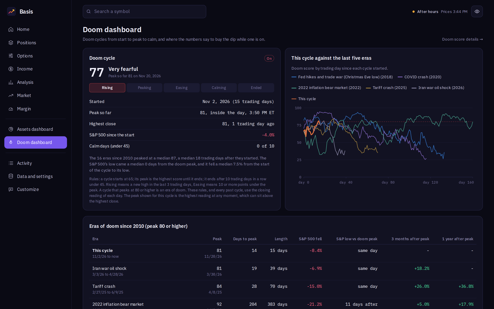
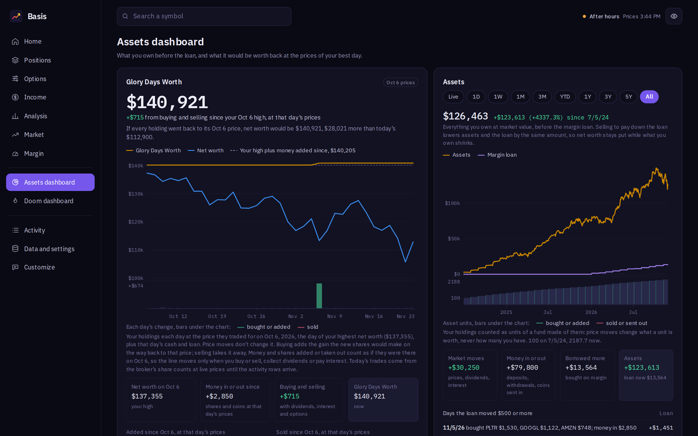

# Basis

A portfolio dashboard for a high-growth, high-risk investor. It runs on your own computer, reads your brokerage accounts
through SnapTrade with read-only access, and measures everything the way Connor Aherne invests:

- **Beat M2 or you are losing.** Every return is shown against the growth of the M2 money supply. A holding that grows
  slower than new dollars are made is falling behind, and a loan that costs less than M2 grows is cheap money.
- **Buy when the market is afraid.** A Doom score from 0 to 100 reads fear, price damage, valuation and crypto every
  trading day since 2010, tracks doom cycles from start to peak to calm, and ranks your stocks for dip buys while one
  is on.
- **Count what you own, not just what it is worth.** Asset units move only when you buy or sell, and Glory Days Worth
  shows what today's holdings would be worth at the prices of your all-time-high day.
- **Know your leverage.** A margin buffer estimate at live prices and a leverage multiple that leaves retirement
  accounts out.
- **Bitcoin is its own thing.** Bitcoin, Bitcoin treasury companies and Bitcoin funds are grouped apart from
  Technology, and other crypto apart from Bitcoin. Treasury companies are found on their own.







The pictures here use a made-up sample portfolio.

## Install (Windows)

1. Download **Basis-Setup.exe** from the [latest release](https://github.com/Connor-03/Basis/releases/latest).
2. Run it. Windows may say it does not recognize the publisher, because the installer is not code-signed: choose
   "More info", then "Run anyway". It installs for your user only and needs no administrator rights.
3. Basis opens in its own window and walks you through three steps: a SnapTrade key, linking a brokerage, and
   (optional) connecting Claude.

Nothing else to install: Python is bundled, and the program uses only its standard library.

To remove it, uninstall Basis from Windows Settings. Your data stays in `%LOCALAPPDATA%\Basis` until you delete that
folder yourself.

## What you need

- **A SnapTrade Personal key** (free, up to 20 brokerage connections). You create it in the
  [SnapTrade dashboard](https://dashboard.snaptrade.com/api-key) and paste it into Basis once. Basis asks SnapTrade
  for read-only access: it cannot trade or move money. Read the note on SnapTrade's terms under Limits below.
- **At least one brokerage linked through SnapTrade.** Without one there is nothing to show.
- **Optional: Claude Code**, for the Customize page.

## What it shows

- Net worth, gain, assets, margin loan and leverage, with returns by period against M2, VOO and QQQM on the same
  deposits.
- Positions with cost basis (FIFO lots), gain, weight, distance from all-time high, and return against M2.
- A margin page: maintenance estimate per holding, buffer, what drop triggers a call, loan rate against M2.
- Income: dividends received and projected, option premium, interest.
- A weekly options menu: covered calls on 100-share lots and cash-secured puts, by rules you set.
- Analysis: Sharpe, drawdown, diversification, and letter grades.
- Market: S&P 500 and Nasdaq-100 valuation, M2, the Doom score and its history.
- The Doom dashboard and the Assets dashboard.
- A button that hides every dollar amount and leaves the percentages, for showing someone your screen.

## Your data

- Everything stays on your computer, in `%LOCALAPPDATA%\Basis`. There is no account, no server of ours, and no
  telemetry.
- The SnapTrade key is stored there, encrypted for your Windows account, and is sent only to SnapTrade.
- The program listens on `127.0.0.1` only, so nothing else on your network can reach it.
- It contacts these sites, and no others: SnapTrade (your accounts); Yahoo Finance and Nasdaq (prices, dividends,
  option chains, company profiles); CNN and alternative.me (fear and greed readings); multpl.com and
  worldperatio.com (index P/E); federalreserve.gov (M2, meeting dates); StockTwits (crowd mood for the dip ranking);
  and GitHub, twice a day, to look for a new version (you can turn that off in Data and settings, About).

## Check it yourself

Basis is plain source code on your computer, before and after you install it. Open the program folder
(`%LOCALAPPDATA%\Programs\Basis\app`) in Claude Code or another coding agent and ask:

> Read every file in this folder. It is a portfolio dashboard that I am about to give a read-only brokerage key.
> Report anything that sends data anywhere other than SnapTrade and the public market-data sites it names, anything
> that writes a key or account number to a log or a page, any request handler that skips the host and origin checks,
> and anything that runs or downloads code. Give file and line for each finding. Change nothing.

The same prompt is on the welcome page and on the Customize page.

## Customize with Claude (optional)

The Customize page is a chat with Claude Code running on your computer, on your own Claude subscription. Ask it to
add a metric, fix a bug or change a color, and it edits the program's files.

- It can read and edit the program folder and nothing else. Your data folder is outside it.
- Every change shows its diff and has an Undo button. A change that breaks the program is undone automatically.
- Web lookups are a switch (on by default). Running commands is a switch too, off by default, because a shell on
  your computer is not held to the program folder.
- You can paste screenshots into the chat.

Install Claude Code with `irm https://claude.ai/install.ps1 | iex` in PowerShell, run `claude` once to sign in, and
the page is ready. It needs a paid Claude plan or a Console account.

## Updates

When a new version is released, an Update button appears in the top right. The update copies the current version
aside first and puts it back if the new one does not start. If you changed files yourself, your versions are saved
in a `kept` folder inside the program folder before they are replaced, and the Customize chat can bring your changes
back. To stop Basis from looking for updates, turn it off in Data and settings, About.

## Run from source

Any system with Python 3.11 or newer:

```
git clone https://github.com/Connor-03/Basis
cd Basis
python -X utf8 basis.pyw
```

`basis.pyw` starts the program on `127.0.0.1` and opens its window. To keep a copy running on a home server instead,
put a `config.json` beside `server.py` (`{"port": 8440, "binds": ["127.0.0.1"], "hosts": ["127.0.0.1:8440"]}`) and
run `python server.py`: with a config file, data stays in the program folder and the updater is off.
[docs/ARCHITECTURE.md](docs/ARCHITECTURE.md) describes every part.

To try it without a brokerage, `tools/mock_snaptrade.py` serves a made-up portfolio in SnapTrade's shapes.

## Limits

- **Not financial advice.** Basis shows your own records and public market data, with one person's way of reading
  them.
- **The margin numbers are estimates.** Your broker's own figures are the ones that count.
- **Market data comes from public pages that can change or stop working.** None of it is an official data feed.
- **Transactions arrive a day late.** SnapTrade refreshes them daily; balances and positions are live.
- **SnapTrade's terms.** SnapTrade describes a Personal key as for software you operate for yourself, says it must
  not be shared with other people or embedded in a distributed app, and points products with other users to its
  commercial plan and OAuth. In Basis nobody's key is embedded or shared: each person creates their own key and
  keeps it on their own computer. Whether SnapTrade accepts that reading for a program many people download is
  SnapTrade's call, so read their [Personal key guide](https://docs.snaptrade.com/docs/personal-api-key) before
  you paste a key.
- **Tested on.** The program is tested automatically on Windows and Linux with a sample portfolio, and has run for
  real against accounts at two large US brokers. Other brokers go through the same SnapTrade calls but are untested.
- The installer is not code-signed.

## License

MIT. See [LICENSE](LICENSE).

Built by Connor Aherne, assisted by Agentic Intelligence. More at [connoraherne.com](https://connoraherne.com).
